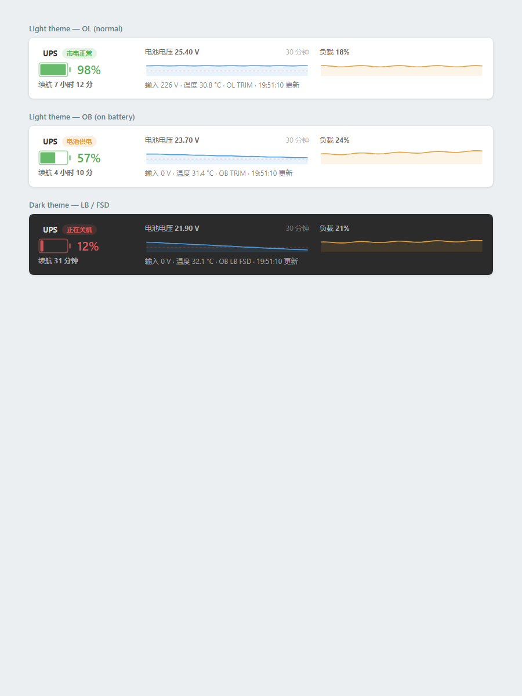

# Richcomm UPS → NUT（PVE 原生方案）

把一台 2005 年的 Richcomm `UPS USB MON V1.4`（USB `0925:1234`，低速 HID）从"只有 Windows 下 32 位原厂程序、USB 一抖就掉线"的状态，接到 Proxmox VE 9 的 NUT 上，附带网页状态卡片、钉钉告警和一套按实测标定的电量/续航模型。

> 本仓库是 2026-10-29 至 10-30 这次改造的完整成果与复盘。硬件是老的，代码是按现场设备反向出来的，不是通用驱动。

## 现状（2026-10-30 09:30）

- PVE `9.2.24` / kernel `7.0.14-23-pve`，UPS 链路正常：`OL TRIM`，输入 223 V，负载 22%。
- 电池组 `2 × 12 V 45 Ah` 串联，NUT 显示整组 25.60 V（原厂 raw 24.8 V + 0.80 V 校准），模型 SOC 99%，`battery.runtime` 2970 s。
- **但满电续航只有约 50 分钟（22% 负载），不是 6 小时。** 实测可用能量约 73 Wh，标称 1080 Wh 的 7%。原因见 [电池诊断](docs/02-电池诊断-2026-10-30.md)。
- 内置充电器是涓流，给 45 Ah 组一夜只补 0.4 V；下一步用 24 V/5–10 A 外接充电器复测。
- 群晖 NAS 的 WOL 未生效，待手动开机后在 DSM 里打开"启用 Wake on LAN"。



## 硬件与环境

| 项 | 值 |
|---|---|
| UPS | Richcomm / Power Manager，USB `0925:1234`，低速 HID，接口 0 |
| 主机 | ThinkServer TS250，PVE 9.2.24，`192.168.88.1` |
| 电池 | 2 × 12 V 45 Ah 铅酸串联（标称 1080 Wh） |
| 原厂软件 | `/opt/ups-manager`（32 位 i386，`ups_config` / `ups_monitor` / `ups_status`，`TimeCfg.conf`） |
| 下游 | 群晖 NAS 以 NUT 客户端接入；PVE 网页卡片；钉钉机器人 |

原厂 `ups_monitor` 走 usbhid/hiddev，250 Hz 轮询，USB 一有风吹草动就 `ENODEV`，且检测不到"进程活着但读数为零"。本项目用 libusb 直接 claim interface 0，按设备能接受的 1.2 s 节奏发 `Q1`，绕开 hiddev 整条链路。

## 架构

```
┌──────────────┐   USB HID 0925:1234    ┌────────────────────────────────┐
│ Richcomm UPS │◄──── libusb ──────────►│ ups-poller (Python/libusb)     │
└──────────────┘   Q1 @1.2s, TL/CT      │  /run/ups-poller/state.json     │
                                        │  /run/ups-poller/screen.txt     │
                                        │  AC-fail/LB 计时（TimeCfg）     │
                                        └──────────────┬─────────────────┘
                                                       │ 1 s
                                        ┌──────────────▼─────────────────┐
                                        │ nut_bridge.py                  │
                                        │  SOC 积分 / 续航模型 / 告警状态 │
                                        │  /run/ups-bridge/ups.dev        │
                                        │  /usr/share/pve-manager/js/     │
                                        │    ups-status.js（JSONP）       │
                                        └───────┬────────────────┬───────┘
                                                │                │
                                      dummy-ups │                │ JSONP
                                      + upsd    │                ▼
                                   ┌────────────▼───────┐  ┌──────────────────┐
                                   │ NUT 192.168.88.1:  │  │ PVE 节点摘要卡片 │
                                   │ 3493 → NAS / upsc  │  │ pve-ups-status.js│
                                   └────────────┬───────┘  └──────────────────┘
                                                │
                                   dingtalk_monitor.py → 钉钉机器人
```

关键点：

- **USB 只有一个主人。** `ups-poller.service` 与 `ups-manager.service` 互斥（`Conflicts=`），原厂程序保持 disabled。
- **NUT 只读。** `dummy-ups` 的 `ups.dev` 由桥接每秒重写；群晖用 `monuser` 只读账号。
- **关机链仍走原厂。** AC 断电达到 `TimeCfg.conf` 的 F 秒后，poller 调 `/opt/ups-manager/shutdown.sh`；电池低到 L 秒同理。桥接在 `shutdown.sh` 触发后置 `FSD`。
- **状态是算出来的。** 原厂电量是按电压查表，断电瞬间会从 97% 跳到 50%，不能当 SOC。桥接维护 `/var/lib/ups-pve/battery.json`，按能量积分。

## 组件

| 文件 | 作用 |
|---|---|
| `deploy/ups-poller` | 核心。libusb 轮询、状态解析、写 `state.json`/`screen.txt`、AC-fail 与 LB 计时、调 `shutdown.sh` |
| `deploy/nut_bridge.py` | `state.json` → `dummy-ups` 的 `.dev`；SOC/续航模型；JSONP 给网页；`FSD` 处理 |
| `deploy/runtime.conf` | 续航模型与电压阈值，改完约 10 秒生效，不用重启 |
| `deploy/ups-selftest.py` | 发 `T` / `T10` / `TL` / `CT`，可停 poller 独占设备 |
| `deploy/ups-selftest-watch.py` | 放电测试监控：按电压/时间/最长时长主动 `CT` |
| `deploy/ups-selftest-guard.py` | `systemd-run --on-active` 的一次性兜底，防止测试跑飞 |
| `deploy/ups-autoct` | 设备掉线重连后自动补发 `CT`，避免自检一直挂在电池上 |
| `deploy/ups-linkcheck` + timer | 每 2 分钟体检：设备在不在、端口配置、poller 是否新鲜，异常抓现场 |
| `deploy/ups-net-watch` | UPS 状态与网卡 link 的相关性日志，用来排除"UPS 掉线其实是网卡" |
| `deploy/ups-fastlog.py` / `ups-screenlog.py` / `ups-soak.py` / `ups-discharge.py` | 1 s / 3 s / 1 min / 10 s 的诊断记录器 |
| `deploy/usbmon-ups.py` | usbmon 抓包，保留 USB 层证据 |
| `deploy/dingtalk_monitor.py` | 市电丢失、低电、通信中断、温度/负载异常的钉钉告警 |
| `deploy/pve-ups-status.js` + `patch-pve-gui.sh` | PVE 节点摘要里的 UPS 行；APT 钩子在 pve-manager 升级后自动补回 |
| `deploy/fix-hiddev.sh` | 仅原厂程序需要：按 sysfs 重建 `/dev/usb/hiddevN` |
| `deploy/install.sh` | 一键部署（NUT conf、systemd、udev、GUI） |
| `windows/wol-ups.ps1` | 早晨 8 点唤醒 PVE/NAS；用 TCP 端口判活，不信 ping |

## 快速部署

前置：PVE 已装 `nut nut-server nut-client libusb-1.0-0 python3`，且 `/opt/ups-manager` 存在（提供 `TimeCfg.conf` 与 `shutdown.sh`）。

```bash
cd deploy
sudo ./install.sh

# 群晖要连的只读账号：先改密码，再启用
sudo editor /etc/nut/upsd.users      # 仓库里是 CHANGE_ME，必须改
sudo systemctl restart nut-server

# 钉钉（可选）
sudo install -d -m 700 /etc/ups-dingtalk
sudo install -m 600 dingtalk.env.example /etc/ups-dingtalk/dingtalk.env
sudo editor /etc/ups-dingtalk/dingtalk.env   # 填 webhook 与加签 secret
sudo ./install-dingtalk.sh
```

验证：

```bash
upsc ups
systemctl status ups-poller ups-nut-bridge nut-server ups-net-watch
curl -s http://127.0.0.1:8006/ | grep -c pve-ups-status   # 卡片脚本已注入
```

卸载/回退：停 `ups-poller` 与 `ups-nut-bridge`，`systemctl enable --now ups-manager` 即回到原厂程序；NUT 侧删掉 `/etc/nut/*.conf` 中本项目段落即可。

## 关键发现

1. **原厂"电量"是电压查表。** `charge% = round((V_block − 10.0) × 10) / 36`，每 0.1 V/块跳 2.78%，整组满量程被压在 20.0–27.2 V。它的电压是 0.1 V 步进的 ADC，带 ±1 格抖动，不能用来估 SOC。详见 [原厂电量表修正](docs/06-原厂电量表修正.md)。
2. **24.6 V 不是 64% 电量，是充电器顶住的表面电压。** 同样从 24.6 V 起放：01:22 那次跑了 63m53s 到 21.6 V；04:11 这次 6.5 分钟就到 22.2 V。中间 1.5 小时市电几乎没有真正充入。
3. **内置充电器是涓流。** 充电器空载 28 V，但 3.5 小时空载只把电池从 24.4 V 抬到 24.8 V。28 V 只证明有输出，不证明带载有电流。
4. **电池内阻偏高。** 3 A 负载下 6.5 分钟从 25.6 V 掉到 23.0 V，折算约 0.9 Ω；可能是端子接触（电池线被拆装过）或电池老化/容量虚标。
5. **固件关机电压读不出来，只能推断。** 没有读命令，也没有升级工具。唯一实测点是 21.8 V 时状态位 `0x40`（低电蜂鸣），硬切断推断在 20.0–21.0 V，模型取 21.0 V 保守值。
6. **Intel AMT 会在 S5 下回 ping。** PVE 主板的 AMT 在系统关机时仍应答 ICMP（TTL 255，16992 开放），所以 WOL 脚本必须用 TCP 端口判活，不能用 ping。详见 [WOL 与 AMT](docs/04-WOL与AMT.md)。

## 续航模型

`runtime.conf` 里的核心关系：

```
usable_wh = RUNTIME_MINUTES / 60 × REFERENCE_LOAD_PCT / 100 × RATED_WATTS
runtime_s = usable_wh / power_watts × 3600 × SOC × 低压降额
```

当前标定：`RUNTIME_MINUTES=50`、`REFERENCE_LOAD_PCT=22`、`RATED_WATTS=400` → 可用能量约 **73 Wh**；`VOLTAGE_DERATE_START=22.6` 到 `VOLTAGE_CUTOFF=21.0` 之间线性降额；`LB_VOLTAGE=22.0` 比 UPS 自身 21.8 V 低电蜂鸣提前 0.2 V。

标定依据是一次 63m53s、18% 负载、放到 21.6 V 的实测：输出约 77 Wh，折算到 22%（88 W）约 52 分钟，取 50 分钟留 4% 余量。`upsc` 验证：18% 负载 3630 s，22% 负载 2970 s。

> 注意：模型 SOC 仍按"正常充电"推到 99%，所以 2970 s 是**满电可用**的估计，不是现在这块电池真实能撑的时间。等外接充电器把电池真正充满后再复测。详见 [续航模型标定](docs/03-续航模型标定.md)。

## USB 协议速查

- 设备：`0925:1234`，低速 HID，interface 0，6 字节中断 IN 帧。
- 命令一律走 `SET_REPORT` 控制传输：`bmRequestType=0x21`、`bRequest=0x09`、`wValue=0x0200`、`wIndex=0`。
- 帧：`A3` + 命令字符 + `0D`。`TL` = `A3 54 4C 0D`，`CT` = `A3 43 54 0D`。
- 前置：`SET_IDLE`，`80 D0 00 00`，再按 0.2 s 间隔发 `I`、`F`、`Q1`；命令在 `Q1` 后 1.5 s 发。
- 状态字节：`0x09` 市电+稳压，`0x80` 市电失败，`0x04` 自检，`0x40` 低电（实测 21.8 V 出现），`0x89` 电池供电，`0x8D` 电池+自检（TL 中）。
- `ac_fail` 判定：状态位 `0x80` 或输入电压 < 50 V。`testing`：`0x04`。

细节见 [架构与协议](docs/01-架构与协议.md)。

## 目录

```
deploy/   可部署文件（install.sh 在此目录执行）
docs/     架构、诊断、标定、复盘
logs/     四次放电测试记录与原始 CSV
windows/  WOL 唤醒脚本与计划任务注册
legacy/   Ubuntu 24.04 下跑原厂 32 位程序的旧方案（已被原生方案取代）
```

## 脱敏说明

仓库内**不含**任何真实凭据：

- 钉钉 webhook token / 加签 secret 只存在于主机 `/etc/ups-dingtalk/dingtalk.env`（600），仓库只给 `dingtalk.env.example`。
- `deploy/upsd.users` 的密码已改为 `CHANGE_ME`；部署时必须改成与群晖一致的值。
- 不含原厂 `setup.exe`、安装 tarball、PDF 手册和 `payload/` 二进制。
- Windows 脚本中的 MAC/IP 是内网地址，按需替换。

## 已知限制

- 原厂 0x40 低电阈值的精确值无法读取；21.8 V 只是"观测到蜂鸣"的点。
- 真实市电中断 1 小时后 `shutdown.sh` 的完整关机链从未跑过（测试都用 TL 自检，市电仍在）。
- 桥接的 SOC 在"没充满但显示 99%"这一点上仍会误导；等电池问题解决后再收紧 `CHARGE_HOURS`/满电判据。
- PVE 升级会替换 `index.html.tpl`，已用 APT 钩子 `99pve-ups-gui` 自动补，但仍建议升级后看一眼卡片。
- 群晖 WOL 未验证；NAS 关机期间 NUT 客户端不会重连，需要开机后确认。

## 文档

- [任务总结（2026-10-30）](docs/00-任务总结-2026-10-30.md)
- [架构与协议](docs/01-架构与协议.md)
- [电池诊断](docs/02-电池诊断-2026-10-30.md)
- [续航模型标定](docs/03-续航模型标定.md)
- [WOL 与 AMT](docs/04-WOL与AMT.md)
- [运维手册](docs/05-运维手册.md)
- [测试历史](logs/ups-test-history.log)
- [原厂电量表修正](docs/06-原厂电量表修正.md)
